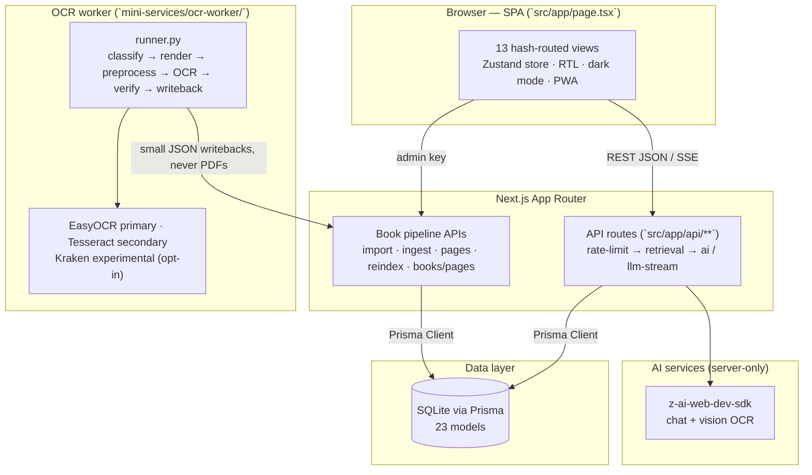
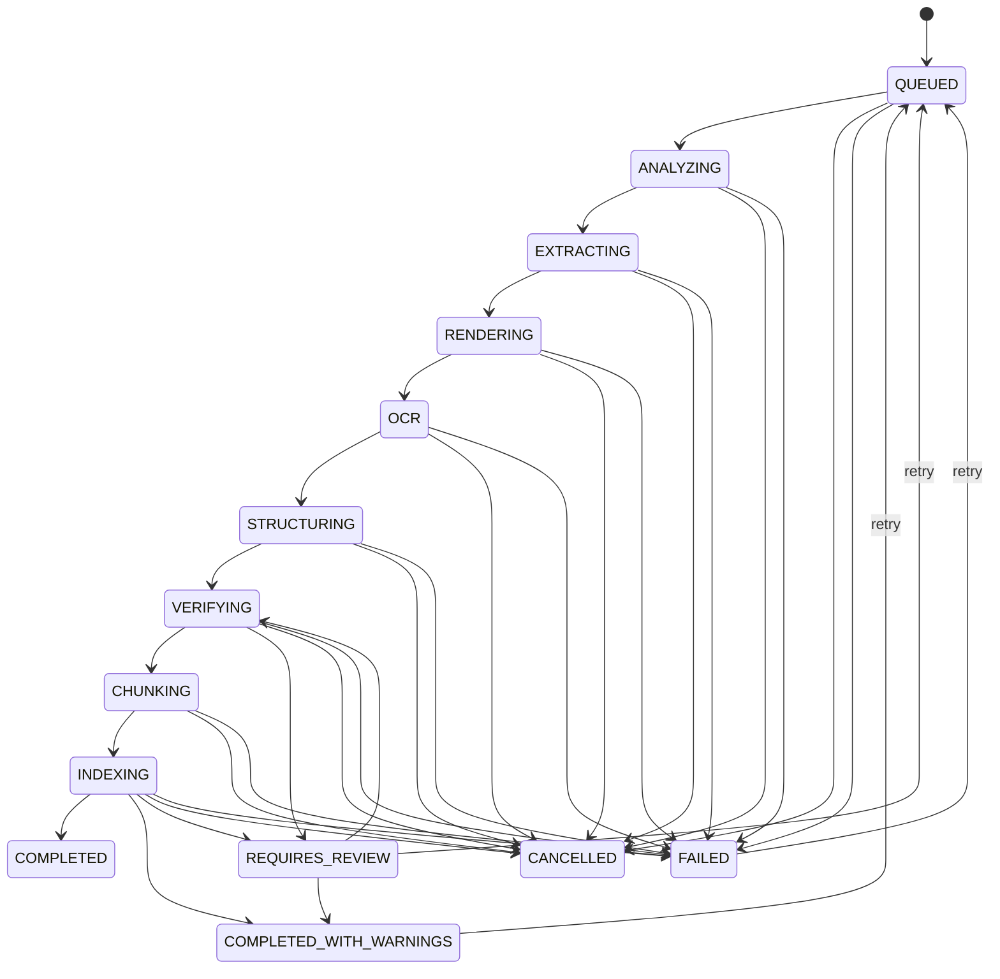

# Nur al-Usul — Trilingual Islamic Research Platform + Book Digitization Pipeline

> A source-based, citation-first research platform for Hanafi fiqh, Sunni aqeedah, and scholarly verification — in English, اردو, and العربية — with a production-hardened pipeline that turns scanned Islamic books into trustworthy, review-gated evidence.

[](https://nextjs.org/)
[](https://www.typescriptlang.org/)
[](https://tailwindcss.com/)
[](https://www.prisma.io/)
[](https://www.sqlite.org/)
[](./tests/)
[](./mini-services/ocr-worker/tests/)
[](./eslint.config.mjs)
[](./package.json)
[](./docs/PHASE_16_FINAL_REAL_BOOK_OCR_BENCHMARK.md)
[](./src/lib/i18n.ts)
[](./public/manifest.webmanifest)
[](#license--disclaimer)

---

## Table of Contents

- [1. Overview & Status](#1-overview--status)
- [2. System Architecture](#2-system-architecture)
- [3. Book Ingestion Pipeline](#3-book-ingestion-pipeline)
- [4. Job Lifecycle State Machine](#4-job-lifecycle-state-machine)
- [5. Evidence & Grounding Chain](#5-evidence--grounding-chain)
- [6. Measured Results](#6-measured-results)
- [7. Key Features](#7-key-features)
- [8. Screens / Views](#8-screens--views)
- [9. AI Engines](#9-ai-engines)
- [10. Tech Stack](#10-tech-stack)
- [11. Data Model](#11-data-model)
- [12. API Reference](#12-api-reference)
- [13. Internationalization & Design System](#13-internationalization--design-system)
- [14. Getting Started](#14-getting-started)
- [15. Configuration](#15-configuration)
- [16. Deployment](#16-deployment)
- [17. Security & Anti-Hallucination Policy](#17-security--anti-hallucination-policy)
- [18. Admin & Editorial Workflow](#18-admin--editorial-workflow)
- [19. Project Structure Map](#19-project-structure-map)
- [20. Documentation Map](#20-documentation-map)
- [21. Development History](#21-development-history)
- [22. Roadmap](#22-roadmap)
- [23. Contributing](#23-contributing)
- [24. License & Disclaimer](#24-license--disclaimer)
- [25. Acknowledgements](#25-acknowledgements)

---

## 1. Overview & Status

**Nur al-Usul** (نور الأصول, "Light of the Principles") is built around one principle: **every claim must be traceable to a verifiable source**. It combines a curated knowledge base (Qur'an, hadith, books, scholars, fatwas, misconceptions, objections, madhhab comparisons), AI claim-checking and answer engines with live SSE streaming, and a full **book-processing pipeline** that ingests scanned Islamic volumes page by page — with checksums, resumable jobs, dual OCR capture, human review gates, and provenance-preserving search indexing.

### Status dashboard (measured, not claimed)

| Area | Result | Evidence |
|---|---|---|
| Test suite | 97 Bun + 95 pytest passing, ESLint 0, build green | `tests/`, `mini-services/ocr-worker/tests/`, `eval/tests/` |
| Pipeline integrity | Recovery, resume, cancel, idempotency, provenance proven on real books | `docs/PHASE_15_CONTROLLED_REAL_BOOK_PILOT.md` |
| Real-book pilot | 68 pages processed, 0 failures, 100% review-routed, 0 silently trusted | Phase 15 report §6–§13 |
| OCR quality (Urdu Nastaliq) | **Gated — not usable yet** (best measured: 14/57 lines, coverage 0.47) | `docs/PHASE_16_FINAL_REAL_BOOK_OCR_BENCHMARK.md` |
| Human ground truth | 7/7 validated; 20–30 target incomplete | `eval/datasets/phase16-frozen-v1.json` |
| Production OCR | EasyOCR primary + Tesseract secondary — **unchanged** | `docs/URDU_OCR_ENGINE_MATRIX.md` |
| Search precision on pilot OCR | Effectively nil (downstream of OCR quality, not ranking) | Phase 15 report §11 |

> **Honest summary for decision-makers:** the ingestion machinery is sound and repeatable; the blocker is OCR capability for Nastaliq scans, not pipeline design. Bulk ingestion is therefore gated until the OCR layer earns it.

---

## 2. System Architecture



Key design decisions:

- **Hash SPA on `/`** — shareable `#/...` deep links with preserved language/theme context.
- **SQLite now, PostgreSQL later** — schema comments document the enum/JSON mapping so the DB can be swapped without UI changes.
- **Single LLM call, dual output** — the streamed draft the user watches *is* the text the parser persists; no second call, no drift.
- **Citation honesty** — verification statuses (`VERIFIED / PARTIAL / DISPUTED / UNVERIFIED`) are first-class data, never inferred silently.
- **OCR worker isolation** — the Python worker never touches the database directly; every write goes through the keyed Next.js API as small JSON.

---

## 3. Book Ingestion Pipeline

```mermaid
flowchart LR
    PDF["Original PDF<br/>(immutable, sha256-pinned)"] --> VAL["Import: magic bytes,<br/>size cap, checksum dedupe"]
    VAL --> JOB["Job: transactional<br/>page stubs 1..N"]
    JOB --> RUN["Worker run<br/>per-page, constant memory"]
    RUN --> P["Primary OCR<br/>EasyOCR ~70 s/pg CPU"]
    P --> S["Secondary OCR (review-routed)<br/>Tesseract ~9 s/pg"]
    S --> V["Verify: NEEDS_REVIEW<br/>+ reasons + confidence"]
    V --> H["Human review → verifiedText<br/>(only promotion path)"]
    H --> IDX["Reindex: 1 page = 1 doc<br/>atomic delete+rebuild"]
    IDX --> RAG["Retrieval → answer context<br/>→ citation → viewer"]
```



Measured stage behavior (68-page real pilot, CPU-only, dual capture ≈ 42 pages/hour):

- Import → stored original, byte-identical, checksum-verified before any OCR spend.
- Job creation, cancel, retry, and counters are single-transaction operations.
- Worker resume selects only `PENDING | QUEUED | FAILED` pages; secondary gaps repair without redoing primary OCR.
- Kill mid-run → zero partial writes, zero duplicates, exact-once resume (proven live).
- `finish` derives the terminal status from page counters and refuses (`409`) while work is resumable — a job is never marked done over unprocessed pages.

---

## 4. Job Lifecycle State Machine



Rules enforced server-side (`src/lib/book-processing.ts`, `409` on violation):

- Only single legal hops; `advance-to`/`finish` walk the chain transactionally — no skipped states are ever recorded.
- Page states: `PENDING → QUEUED → OCR_DONE → INDEXED`, with `NEEDS_REVIEW` / `FAILED` side states.
- Three text layers stay separate forever: raw primary `ocrText` ≠ secondary `ocrTextSecondary` ≠ human `verifiedText`.

Full tables: `docs/BOOK_PROCESSING_STATE_MACHINE.md`.

---

## 5. Evidence & Grounding Chain

```mermaid
flowchart LR
    SRC["Stored original<br/>(checksum)"] --> OCR["OCR evidence<br/>(engine + confidence)"]
    OCR --> REV["Review<br/>(UNVERIFIED lead)"]
    REV --> VT["verifiedText<br/>(human only)"]
    VT --> DOC["SearchDocument<br/>(1 page = 1 doc)"]
    DOC --> RET["Retrieval<br/>(provenance attached)"]
    RET --> CTX["Answer context<br/>(S1..Sn, delimited)"]
    CTX --> ANS["AI answer<br/>(citations validated)"]
    ANS --> CIT["Citation → viewer<br/>(book/jild/page)"]
```



Guardrails (tested, not slogans):

- Secondary/new OCR text never enters the index, retrieval, or AI context.
- Unverified passages are labeled `UNVERIFIED — retrieval lead only, do NOT present as confirmed quotation`.
- Unknown citation IDs resolve to `UNRESOLVED`, never invented replacements; unverified-only evidence caps confidence at `LOW`.
- The public source viewer exposes workflow identifiers, status, and primary/verified text — secondary captures stay behind the keyed admin review API.

---

## 6. Measured Results

### OCR benchmark (7 human-ground-truth pages, 200 DPI, 57 reference lines)

| Configuration | Lines matched | Token recall | Mean s/page | Verdicts |
|---|---:|---:|---:|---|
| EasyOCR `ar,en` (production) | 4/114 rec (3.5%) | 0.124 | 72.2 | 14/14 REVIEW |
| EasyOCR `ur` / `ur,en` | 4/114 (3.5%) | 0.19 | 64–68 | 14/14 REVIEW |
| Tesseract standard | 1/114 (0.9%) | 0.225 | 9.0 | 14/14 REVIEW |
| Tesseract best-`urd` | 3/114 (2.6%) | 0.332 | 3.1 | 14/14 REVIEW |
| **Kraken + OpenITI Urdu (experimental)** | **14/57 (24.6%)** | **0.471** | ~50 | 7/7 REVIEW |

Takeaways: Urdu language tags on EasyOCR change nothing (same underlying Arabic-script model); `tessdata_best` helps modestly; Kraken is materially better — readable Urdu prose vs. word salad — but still a **production candidate, not production-ready** (7 pages cannot authorize a switch).

### Real-book pilot (Fatawa-e-Ridawiyyah, vol. 4, 68 pages)

| Metric | Value |
|---|---|
| Pages processed / failed | 68 / 0 |
| Review-routed | 68 (100%) |
| Human-verified | 0 — unusable text was never promoted |
| Secondary capture | 68/68, 0 failures |
| Provenance complete (book→jild→page→source→engine→checksum) | 68/68 |
| Index docs / duplicates | 68 / 0, reindex idempotent ×3 |
| Search plumbing (book/jild/route on every hit, jild scoping both ways) | correct |
| Recovery (hard kill → resume; cancel → 409 guards) | clean |

### Test suite

| Suite | Result |
|---|---|
| Bun (`tests/`, 10 files) | 97 passed, 0 failed |
| Pytest worker (`mini-services/ocr-worker/tests/`) | 76 passed |
| Pytest eval lab (`eval/tests/`) | 19 passed |
| ESLint | 0 errors |
| Production build | green (36 routes) |

---

## 7. Key Features

### Research & Knowledge

- **Knowledge Hub** — topics by category (Aqeedah, Fiqh, comparative fiqh) with deep links.
- **Question Bank** — clustered questions with detail pages and admin curation.
- **Misconception / Objection databases** — claim → scholarly correction → evidence → status, shareable detail pages, related-research trails.
- **Madhhab Comparison Engine** — side-by-side school comparisons with focus deep-links.
- **Sources Library** — books, scholars, fatwas with manuscript-style reader and page-level viewer.
- **Qur'an & Hadith Viewer** — illuminated panels, Arabic-first typography, grading seals.
- **Global Search + ⌘K/Ctrl+K** — dialog + full search view with type filters.

### AI & Verification

- **Claim Checker ("Is This Really Hanafi?")** — streamed verdict with classification, confidence, typed evidence bullets.
- **Answer Engine** — streamed scholarly draft persisted as a structured, citable answer card.
- **Anti-hallucination guarantee** — no evidence → explicit "could not be verified"; uncertain citations stay `UNVERIFIED`.

### Reading & Platform UX

- Citation-first UX (`ShareBar`, copy/print), My Library with exports, Continue Reading, related-research trails, reader feedback votes.
- Trilingual EN/اردو/العربية with full RTL mirroring; dark mode; installable PWA with offline shell.
- Admin CMS: dashboard stats, feedback signals, 10-entity CRUD editor, bulk operations, pagination.

---

## 8. Screens / Views

Hash router in `src/app/page.tsx` + `src/lib/store.ts`. All routes are hash fragments served from `/`:

| Hash | View file | Description |
|---|---|---|
| `#/` | `views/home.tsx` | Courtyard hero, stats, library strip, categories, books |
| `#/knowledge[/{slug}]` | `views/knowledge.tsx` | Categories → topics → detail |
| `#/bank[/{slug}]` | `views/bank.tsx` | Question-bank clusters |
| `#/misconceptions[/{slug}]` | `views/misconceptions.tsx` | List + citable detail + related trail |
| `#/claims[/{id}]` | `views/claims.tsx` | Streaming claim checker + verdict links |
| `#/objections[/{id}]` | `views/objections.tsx` | List + research detail + comparisons |
| `#/compare[/{id}]` | `views/comparison.tsx` | Madhhab comparison cards |
| `#/sources[/{param}]` | `views/sources.tsx` | Books / scholars / fatwas + page viewer |
| `#/quran` | `views/quran-hadith.tsx` | Qur'an verses + hadith panels |
| `#/search[/{query}]` | `views/search.tsx` | Search courtyard + filtered hits |
| `#/ask` | `views/ask.tsx` | Ask + OCR attach ("Quote into question") |
| `#/qa[/{id}]` | `views/qa.tsx` | Q&A list, streaming answers, feedback votes |
| `#/admin` | `views/admin.tsx` | Dashboard + entity editor + book processing console |

---

## 9. AI Engines

LLM access is **backend-only** via `z-ai-web-dev-sdk` (`src/lib/ai.ts`, streaming in `src/lib/llm-stream.ts`). Retrieval grounds every call in the local KB (`src/lib/retrieval.ts`).

| Engine | Endpoint | UX |
|---|---|---|
| Claim checker (JSON) | `POST /api/claims` | Classic verdict |
| Claim checker (streaming) | `POST /api/claims/stream` | SSE `retrieving → analyzing → verifying → delta* → done` |
| Answer generator (JSON) | `POST /api/answers/generate` | Structured answer draft |
| Answer generator (streaming) | `POST /api/answers/stream` | SSE `retrieving → generating → saving → delta* → done`, persisted `AI_ASSISTED` |
| OCR extraction | `POST /api/ocr` | `{imageBase64, mimeType}` → `{text ≤8000 chars, language, claimSummary}` |

Rate limits (in-memory sliding window): claims 8/min, claims-stream 8/min, OCR 6/min, answers 6/min, questions 12/min, feedback 20/min → `429 + Retry-After`.

---

## 10. Tech Stack

| Layer | Technology |
|---|---|
| Framework | Next.js 16 (App Router, `output: standalone`), React 19, TypeScript 5 |
| Styling | Tailwind CSS 4, shadcn/ui (New York), Radix UI, Framer Motion |
| Fonts (self-hosted) | Amiri, Noto Naskh Arabic, Noto Nastaliq Urdu, Cormorant Garamond |
| Data | Prisma 6 + SQLite (23 models; PostgreSQL-ready schema comments) |
| AI | `z-ai-web-dev-sdk` (server-side only), custom SSE streaming |
| State | Zustand, TanStack React Query, React Hook Form + Zod |
| i18n | Custom EN/UR/AR dictionaries, RTL-aware + `next-intl` dep |
| OCR worker | Python 3.10+, PyMuPDF, Pillow, OpenCV, EasyOCR, Tesseract (+ Kraken opt-in) |
| Eval lab | CER/WER, line-level matching, calibration, error taxonomy, resource tracking |
| Runtime | Bun (`bun.lock`), Node-compatible; PWA manifest + service worker |
| Reverse proxy | Caddyfile (`:81 → localhost:3000`) |
| Lint | ESLint 9 + `eslint-config-next` |

---

## 11. Data Model

`prisma/schema.prisma` — 23 models. SQLite has no native enums/JSON, so enums are documented `String` fields and JSON is serialized `String`.

| Models | Purpose |
|---|---|
| `User` | Accounts, roles, authorship |
| `Scholar`, `Book`, `BookPage` | Sources library + OCR page store (raw primary / secondary / verified layers) |
| `BookProcessingJob` | Job lifecycle, stages, counters |
| `QuranVerse`, `Hadith`, `Fatwa` | Scriptural + fatwa evidence |
| `Category`, `Topic` | Knowledge taxonomy |
| `Misconception`, `Objection`, `Comparison` | Research triangle (cross-linked by `topicId`) |
| `Position`, `ScholarlyView`, `Citation` | Stances, views, source links (page-level deep links) |
| `Question`, `Answer` (+votes) | Ask + AI-assisted answers + feedback |
| `ClaimCheck` | Persisted fact-check verdicts |
| `QuestionCluster`, `QuestionSuggestion`, `SearchDocument`, `SearchLog`, `Review` | Bank, suggestions, search index/logs, editorial review |

Constraints that matter: `BookPage @@unique([bookId, volume, pageNumber])`, `SearchDocument @@unique([entityType, entityId])` (one page = one doc, structurally enforced).

---

## 12. API Reference

Base `/api`. Error convention: JSON `{ error }` with `400 / 404 / 409 / 413 / 415 / 429 (+Retry-After) / 500 / 502`.

**Public / research:** `GET /api/health`, `/api/bootstrap`, `/api/topics`, `/api/misconceptions`, `/api/objections`, `/api/comparisons`, `/api/books`, `/api/scholars`, `/api/fatwas`, `/api/quran`, `/api/hadith`, `/api/search?q=&type=&bookId=&volume=`, `/api/bank*`, `/api/questions`, `/api/claims[/stream]`, `/api/answers/generate|stream|feedback`, `POST /api/ocr`.

**Book pipeline (admin key; reads scoped, mutations keyed):**

| Method & Path | Description |
|---|---|
| `POST /api/admin/import` | Multipart PDF upload: magic bytes, size cap, sha256 dedupe (`409` on duplicate), immutable `storage/books/{id}/original.pdf` |
| `POST /api/admin/ingest` | Create job + transactional page stubs; `409` if an active job exists |
| `GET /api/admin/ingest?jobId=` | Job status + live page summary (counters recomputed from rows) |
| `PATCH /api/admin/ingest` | `advance` (single legal hop) · `advance-to` (walk chain) · `finish` (derive terminal from counters, `409` while resumable) · `cancel` · `retry` |
| `GET /api/admin/pages` | Page list/detail (lean lists; full text states via `pageId`) |
| `PATCH /api/admin/pages` | `verify` · `requeue` (drops index doc atomically) · `fail` · `ocr` · `ocr2` · `retry-secondary` |
| `POST /api/admin/reindex` | Atomic delete+rebuild of `BOOK_PAGE` docs; idempotent |
| `GET /api/books/pages?slug=` | Public paginated viewer (primary/verified layers only — secondary stays in admin review) |

**Admin CMS:** `GET /api/admin/stats`, `/api/admin/resource`, `/api/admin/analytics`, `/api/admin/duplicates`, `POST /api/admin/suggest-questions`.

---

## 13. Internationalization & Design System

- `src/lib/i18n.ts` + `use-loc.ts` hook; full UI in EN/اردو/العربية persisted in `localStorage`.
- RTL-first: `dir` flips on `<html>`, mirrored chevrons/pagination, Nastaliq line-height boost, per-script fonts.
- 70% usability / 20% character / 10% ornament. Light = illuminated manuscript + marble; dark = quiet mosque at night. Emerald-800 + antique-brass tokens, girih/weave/muqarnas SVG patterns (zero network), Cormorant Garamond display serif.
- Icon-safe badges (never color-alone — every status has a distinct Lucide glyph); print stylesheet included.

---

## 14. Getting Started

**Prerequisites:** Bun 1.x (or Node 20+), Git. For the OCR worker: Python 3.10+ and (for secondary capture) a Tesseract binary.

```bash
# 1. Install dependencies
bun install

# 2. Configure environment (.env requires DATABASE_URL, e.g. file:./dev.db)

# 3. Generate client + create database + seed
bunx prisma generate
bunx prisma db push
bunx prisma db seed

# 4. Run dev server (http://localhost:3000)
bun run dev

# 5. Open the app: http://localhost:3000/#/
```

**OCR worker setup** (`mini-services/ocr-worker/`, pinned in `requirements.txt`):

```bash
cd mini-services/ocr-worker
pip install -r requirements.txt   # PyMuPDF, Pillow, OpenCV, numpy, requests, easyocr, torch
# secondary OCR needs the Tesseract system binary + tessdata on PATH
```

**Evaluate an OCR candidate** (never touches production):

```bash
cd mini-services/ocr-worker
python -m eval.bench --engines easyocr --variants raw,restored --limit 3
python -m pytest tests -q        # worker suite (run separately from eval suite)
python -m pytest eval/tests -q   # evaluation framework suite
```

Useful hash routes: `#/knowledge` · `#/misconceptions` · `#/claims` · `#/objections` · `#/compare` · `#/sources` · `#/quran` · `#/search` · `#/ask` · `#/qa` · `#/admin` · `#/bank`

---

## 15. Configuration

| Variable | Purpose / default |
|---|---|
| `DATABASE_URL` | SQLite file path (**required**) |
| `ADMIN_KEY` | Overrides the historic shared admin key |
| `NUR_STORAGE` | Absolute storage root for originals (worker must match the app) |
| `NUR_MAX_UPLOAD_MB` | PDF upload cap (default 100, hard cap 2000) |
| `NUR_API_BASE` / `NUR_API_TIMEOUT_S` / `NUR_ADMIN_KEY` | Worker → API connection |
| `OCR_PRIMARY_ENGINE` / `OCR_FALLBACK_ENGINES` | Engine chain (defaults `easyocr` / `tesseract`) |
| `OCR_EASYOCR_LANGS` / `OCR_EASYOCR_MODEL` | EasyOCR langs + pinned model version |
| `OCR_TESSERACT_LANGS` / `OCR_TESSERACT_CMD` | Tesseract langs + binary |
| `OCR_SECONDARY_MODE` | `review` (default) · `always` · `off` (rollback switch) |
| `OCR_SECONDARY_ENGINE` / `OCR_SECONDARY_MIN_CONF` | Secondary engine + review trigger |
| `OCR_KRAKEN_CMD` / `OCR_KRAKEN_MODEL` / `OCR_KRAKEN_MODEL_VERSION` | **Experimental only** — Kraken stays unavailable unless both paths are set |
| `NUR_EVAL_DIR` | External eval collection so real PDFs never enter git |

---

## 16. Deployment

```bash
bun run build
bun run start   # serves .next/standalone/server.js on port 3000
```

- `output: "standalone"`; the build script copies `.next/static` and `public/` into the standalone folder (cross-platform Node helper, no Unix-only `cp`).
- Serve behind the included `Caddyfile` (port 81) or any Node host / container.
- Persist the SQLite file (mount a volume in Docker); back it up before `db:push --accept-data-loss`.

---

## 17. Security & Anti-Hallucination Policy

- **Admin gate** (`src/lib/admin-auth.ts`): single shared gate, `ADMIN_KEY` env override with historic fallback; all mutations keyed.
- **Rate limiting**: in-memory per-IP sliding windows; single-node scope with documented Redis swap path.
- **Validation**: Zod + per-entity schemas; PDF magic bytes (never MIME); size caps; numeric guards.
- **LLM discipline**: backend-only keys, retrieval-grounded prompts, tolerant parsers, confidence heuristics.
- **Anti-hallucination seed policy**: only well-established citations ship as `VERIFIED`; uncertain data stays `UNVERIFIED`/`NULL`.
- **Accessibility**: skip-to-content, ARIA states, focus rings, `prefers-reduced-motion`, Radix semantics, print isolation.

---

## 18. Admin & Editorial Workflow

`#/admin` — dashboard, entity editor, feedback signals, and the **book processing console**:

1. **Dashboard** — workflow cards, verification breakdown bars, ranked reader-feedback signals, recent questions/claims.
2. **Entity editor** — 10 entities; search + pagination + bulk select/delete + bulk status.
3. **Book processing** — create jobs, watch stage/counters, triage the review queue (reasons + confidence + primary/secondary side-by-side), save verified text, reindex, inspect provenance.
4. **Library export** (reader side) — citations, lists, dated `.txt`.

---

## 19. Project Structure Map

```text
<repo-root>/
├── src/
│   ├── app/
│   │   ├── page.tsx              # SPA shell + hash router (13 views)
│   │   ├── layout.tsx            # fonts, theme, metadata, PWA icons
│   │   ├── globals.css           # design tokens + patterns
│   │   └── api/                  # 30+ REST/SSE endpoints
│   │       ├── admin/import|ingest|pages|reindex|resource|stats|analytics|duplicates|suggest-questions
│   │       ├── answers/generate|stream|feedback  claims|claims/stream
│   │       ├── books|books/pages  bank|bank/*  fatwas  hadith  health
│   │       ├── misconceptions  objections  comparisons  ocr
│   │       └── questions  quran  scholars  search  topics  bootstrap
│   ├── components/
│   │   ├── platform/             # navbar, footer, 13 views/*, 14 shared modules
│   │   └── ui/                   # shadcn/ui primitives (50+ files)
│   ├── lib/                      # ai, llm-stream, retrieval, answer-context,
│   │                             # rate-limit, db, i18n, store, cite, bookmarks,
│   │                             # book-*, search-*, semantic, api, utils
│   └── hooks/
├── prisma/
│   ├── schema.prisma             # 23 models (SQLite; PostgreSQL-ready comments)
│   ├── seed.ts                   # main KB seed
│   └── seed-bank.ts              # question-bank seed
├── mini-services/ocr-worker/     # Python book-processing worker
│   ├── runner.py                 # resumable orchestration (constant memory)
│   ├── engines/                  # easyocr · tesseract · kraken (experimental) · htr-stub
│   ├── eval/                     # benchmark lab: adapters, metrics, fixtures,
│   │                             # ground_truth/, datasets/, transcribe/ (GT workflow)
│   └── tests/                    # worker contract + behavior suite
├── tests/                        # Bun contract + state-machine suite
├── scripts/                      # icon gen, depth translations, standalone packaging
├── public/                       # manifest, sw.js, offline.html, icons, robots
├── docs/                         # phase + architecture docs (see map below)
├── db/  download/  examples/  .zscripts/
├── package.json  bun.lock  tsconfig.json
├── tailwind.config.ts  postcss.config.mjs  components.json
├── eslint.config.mjs  next.config.ts  Caddyfile
└── worklog.md                    # engineering history (Tasks 0–16)
```

---

## 20. Documentation Map

| Document | Covers |
|---|---|
| `docs/BOOK_PROCESSING_STATE_MACHINE.md` | Job/page transitions, `advance-to`/`finish`, idempotency rules |
| `docs/DUAL_CAPTURE_OCR.md` | Review-routed dual capture, secondary isolation, rollback |
| `docs/BOOK_PROCESSING_FOUNDATION.md` | Job/page schema and orchestration contracts |
| `docs/PYTHON_PROCESSOR.md` | Worker execution contract (API-only writebacks) |
| `docs/BOOK_IMPORT_AND_E2E.md` | Real-PDF import flow and end-to-end evidence |
| `docs/VERIFICATION_INDEXING.md` | Text states, verify audit, one-doc-per-page indexing |
| `docs/SEARCH_RETRIEVAL_INTEGRATION.md` | Search scoring, filters, provenance attachment |
| `docs/BOOK_PAGE_AI_INTEGRATION.md` | Answer context, grounding rules, citation validation |
| `docs/FRONTEND_BOOK_INTEGRATION.md` | Viewer/admin UI contracts, deep links |
| `docs/OCR_EVALUATION_LAB.md` + `OCR_EVALUATION_GUIDE.md` | Benchmark harness, commands, metric definitions |
| `docs/REAL_BOOK_OCR_BENCHMARK.md` | Phase 10 real-page measurements |
| `docs/MULTI_ENGINE_REAL_BOOK_BENCHMARK.md` | Phase 11 multi-engine evidence |
| `docs/PRODUCTION_OCR_DECISION.md` + `_V2.md` + `_IMPLEMENTATION_PLAN.md` | Engine decisions and rollout plan |
| `docs/PHASE_14_PRODUCTION_HARDENING.md` + `..._READINESS_REPORT.md` | Hardening record and readiness verdict |
| `docs/PHASE_15_CONTROLLED_REAL_BOOK_PILOT.md` | 68-page pilot: metrics, recovery, search, limits |
| `docs/PRODUCTION_BOOK_INGESTION_RUNBOOK.md` | Repeatable 15-step operator procedure |
| `docs/PHASE_16_STAGE_A_B_RESULTS.md` | Frozen dataset + zero-install evaluation |
| `docs/PHASE_16_STAGE_C_SPECIALIST_OCR.md` | Kraken specialist evaluation |
| `docs/PHASE_16_FINAL_REAL_BOOK_OCR_BENCHMARK.md` | Final 7-page comparison + review burden |
| `docs/URDU_OCR_ENGINE_MATRIX.md` | Side-by-side engine comparison |
| `docs/PHASE_16_HUMAN_GROUND_TRUTH_WORKFLOW.md` | Transcriber guide, checklist, validation ladder |
| `docs/BOOK_PIPELINE_INTEGRATION_AUDIT.md` | Cross-cutting integration audit |

---

## 21. Development History

| Date | Commit | Phase |
|---|---|---|
| 2026-09-09 | Initial commit | Platform foundation |
| 2026-09-10 | Phase 1 | Book processing foundation, page state machine |
| 2026-09-11 | Phase 2 | Transactional job API, resumable page stubs |
| 2026-09-12 | Phase 3 | Python OCR worker (EasyOCR primary, Tesseract fallback) |
| 2026-09-13 | Phase 4 | Admin processing console, job progress, review queue |
| 2026-09-14 | Phase 5 | Public source viewer, paginated page API |
| 2026-09-15 | Phase 6 | Real PDF import, checksum dedupe, safe storage |
| 2026-09-16 | Phase 7 | One-doc-per-page indexing, normalized search, idempotent reindex |
| 2026-09-17 | Phase 8 | Search API/UI with provenance and viewer deep links |
| 2026-09-18 | Phase 9 | BOOK_PAGE AI evidence, retrieval, citation grounding |
| 2026-09-19 | Phase 10 | OCR evaluation lab (metrics, fixtures, ground truth) |
| 2026-09-20 | Phase 11 | Engine decision docs, real-book benchmark, integration audit |
| 2026-09-21 | Phase 12 | Semantic retrieval, question pipeline, trilingual rendering |
| 2026-09-22 | Phase 13 | Review-routed dual capture, secondary isolation |
| 2026-09-23 | Phase 14 | Transactional jobs, cancellation, checksum gate, hardening |
| 2026-09-24 | Phase 15 | Controlled 68-page pilot → **PASS WITH LIMITATIONS** |
| 2026-09-25 | Phase 16-A/B | Frozen 27-page dataset, zero-install evaluation |
| 2026-09-26 | Phase 16-C | Kraken + OpenITI Urdu specialist evaluation → **production candidate** |
| 2026-09-27 | Phase 16-D | Final 7-page benchmark, review-burden analysis |
| 2026-09-28 | Phase 16-D.1 | Human ground-truth workflow + this README |

---

## 22. Roadmap

Honest ordering — capabilities before scale:

- [ ] **Human ground truth**: transcribe the 20 frozen pages (`eval/transcribe/` workstation is ready) → unlocks the production OCR decision.
- [ ] **Production OCR decision**: confirm Kraken on 20–30 pages, then propose (not impose) a default change with rollback plan.
- [ ] **Review ergonomics**: side-by-side correction UI tuned for Nastaliq error classes (dots, finals, joined words).
- [ ] **Page-image rendering** in the viewer (`imageUrl` plumbing exists; no stored page images yet).
- [ ] **Printed-folio mapping**: establish PDF-index → printed-page offsets instead of `null`.
- [ ] **Language detection**: separate Urdu Nastaliq from Arabic (currently all pilot docs label `AR`).
- [ ] **Auth-gated admin** (currently shared-key editorial UI).
- [ ] **PostgreSQL/FastAPI backend swap** (schema is migration-ready).
- [ ] Real-device PWA offline test; answer revision-history UI; trend sparklines; library sort/search.

Explicitly **not** planned without new evidence: unsupervised full-volume ingestion, production OCR default switch, second RAG/search stacks.

---

## 23. Contributing

1. Work in one canonical checkout; keep edits small and typed (`bun run lint` clean).
2. Follow existing conventions: server-only LLM calls, citation honesty (`UNVERIFIED` over guessing), trilingual keys (EN/UR/AR) for every user-facing string, RTL check, dark-mode check, mobile 390px check.
3. Never commit model output as evaluation ground truth; never auto-promote OCR to `verifiedText`.
4. Python changes need pytest cover (`tests/` and `eval/tests/` run separately — shared `conftest` module names collide in one invocation).
5. Update the relevant `docs/` record with measured numbers, not adjectives.
6. Open a PR with screenshots (EN + UR/AR RTL + dark).

---

## 24. License & Disclaimer

- **Code**: provided for educational use. Add an explicit OSS license (e.g. MIT) before public distribution if desired. Engine/model weights used in evaluation carry their own licenses (EasyOCR Apache-2.0; Tesseract/`tessdata_best` Apache-2.0; Kraken Apache-2.0; OpenITI Urdu model Apache-2.0; Surya weights under a modified OpenRAIL-M — evaluation only).
- **Religious content disclaimer**: this platform presents Hanafi/Sunni scholarly material for research and education. It is **not a substitute for qualified scholarship or personal fatwa** — the Ask/Q&A surfaces carry a fatwa-consultation warning. Verify consequential rulings with trusted scholars and primary sources.

---

## 25. Acknowledgements

- Classical Hanafi scholarship and the later South Asian tradition (including *Fatawa Razvia*) whose works populate the sources library.
- OpenITI / Benjamin Kiessling for the printed-Urdu recognition model; the Tesseract, EasyOCR, Kraken, Prisma, Next.js, and open-source communities.
- Amiri, Noto Naskh Arabic, Noto Nastaliq Urdu, and Cormorant Garamond type designers.
- Engineering history preserved in `worklog.md` and `docs/PHASE_*`.

---

*نور الأصول — Understand Hanafi Islam through reliable sources.*
